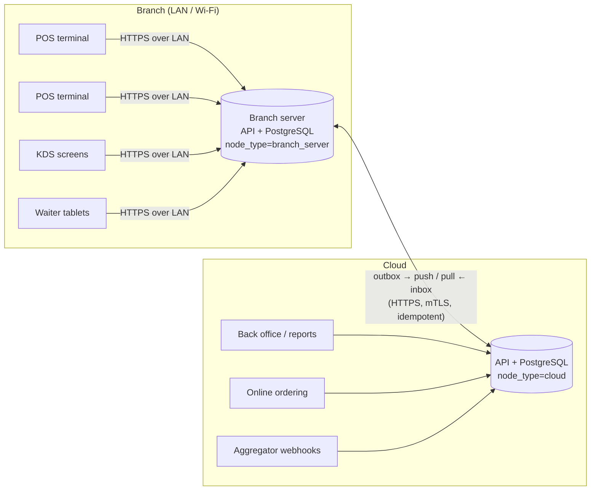

# Architecture & implementation plan

## 1. Inspection findings (before any code was written)

| Item | Finding | Consequence |
|---|---|---|
| Existing project | None. The working directory was empty; no framework, schema or modules to preserve. | Green-field build; nothing replaced. |
| Database | PostgreSQL 16 available locally. | PostgreSQL is the system of record (row-level security, `jsonb`, generated columns, `security_invoker` views). |
| Runtime | Node.js 22. | TypeScript API on Fastify 5. |
| Hosting limits | Cloud container, no inbound public hosting, no WhatsApp/aggregator/payment credentials. | Everything is runnable/testable locally. External integrations are modelled (tables, secret *references*) but **not simulated**; they are built when credentials exist (Phases 6–7). |

## 2. Technology decisions

| Concern | Choice | Why |
|---|---|---|
| Database | PostgreSQL 16, one schema per domain | Relational integrity, RLS for tenancy, same engine on cloud and branch servers (simplifies sync). |
| Keys | UUIDv7 generated by the app (`src/lib/uuid.ts`); `gen_random_uuid()` fallback | Globally unique without coordination → safe to create on an offline branch server or terminal; time-ordered for index locality. |
| API | Fastify 5 + Zod, REST/JSON under `/api/v1` | API-first: every screen (POS, KDS, back-office, online ordering) is a client of the same API. |
| Money/quantities | `numeric(18,4)` / `numeric(18,6)`, returned as strings | No floating-point rounding in financial or stock maths. |
| Migrations | Forward-only numbered SQL with checksums (`src/db/migrate.ts`) | Reviewable DDL; tampering with applied migrations is detected. |
| Tests | Vitest against a real PostgreSQL test database | Security and ledger rules live in the database and must be tested there. |

## 3. Logical domains (database schemas)

`org` organization & branches · `iam` users, roles, permissions, sessions · `crm` customers · `menu` menu, dishes, modifiers, combos, channels, prices · `recipe` recipes · `pos` orders, tables, shifts, reason codes, overrides · `pay` payment methods, payments, cash drawer · `kds` stations, tickets · `inv` items, UoM, warehouses, batches, documents, **stock ledger** · `supl` suppliers · `proc` requisitions, POs, GRNs, invoices · `dlv` zones, riders, deliveries · `agg` aggregators, mappings, external orders · `loy` programs, tiers, **points ledger** · `mkt` consents, templates, segments, campaigns · `exp` expenses · `acct` chart of accounts, tax, periods, **journals** · `sync` nodes, devices, outbox, inbox, checkpoints, conflicts · `audit` audit log.

96 tables, ~495 foreign keys, ~250 indexes. Full dictionary: [SCHEMA.md](SCHEMA.md). Diagrams: [ERD.md](ERD.md).

## 4. Data isolation model (defence in depth)

1. **Tenant columns.** Every tenant row has `company_id`; every operational row has `branch_id`.
2. **Composite foreign keys** `(company_id, branch_id) → org.branches(company_id, id)` make it impossible to attach a record to another company's branch, even from trusted code.
3. **Forced row-level security** on all 92 tenant tables. The API sets `app.company_id`, `app.branch_ids`, `app.all_branches`, `app.user_id` with `SET LOCAL` per transaction (`src/db/pool.ts`), so pooled connections cannot leak context. Without a context, queries see **nothing**.
4. **Least-privilege runtime role** `pos_app`: `NOSUPERUSER NOBYPASSRLS`, no UPDATE/DELETE on ledgers, no DELETE on financial documents.
5. **Application permission checks** (`AuthContext.require(permission, branchId)`) on every route — a permission counts for a branch only if granted for that branch or company-wide.
6. `app.system` (RLS bypass) is only set by trusted server paths: login lookup, platform company creation, the sync engine, seeding.

## 5. Integrity & traceability rules enforced in the database

| Rule | Mechanism |
|---|---|
| Ledgers are append-only (`inv.stock_ledger`, `pay.payments`, `pay.cash_movements`, `pos.order_events`, `kds.events`, `loy.transactions`, `mkt.consents`, `audit.audit_log`) | `forbid_mutation` triggers + revoked privileges. Corrections are reversal rows (`reversal_of_id`). |
| Moving weighted-average cost | `inv.apply_stock_movement` trigger computes cost, value and running balance atomically under a row lock on `inv.stock_balances`. |
| No double posting (retries, sync replays) | `unique (company_id, idempotency_key)` on stock ledger, payments, cash movements, loyalty, journals, payment intents. |
| Traceability | Every posting carries `source_doc_type`, `source_doc_id`, `source_line_id`; `audit.v_document_trace` lists all inventory/journal/payment/loyalty postings for a document. |
| Orders sent to kitchen or posted are never deleted | `pos.guard_order_delete` trigger (applies even to trusted paths). |
| Journals must balance; posted journals immutable; closed periods locked | `acct.guard_journal_entry` / `acct.guard_journal_line` triggers. |
| Approved POs cannot be silently changed | `proc.guard_approved_po` (changes require a revision). |
| No self-approval of overrides | check `approved_by <> requested_by` on `pos.authorizations`. |
| Loyalty movements reference an order or an authorized adjustment | check constraint on `loy.transactions`. |
| Duplicate supplier invoices | `unique (company_id, supplier_id, supplier_invoice_no)`. |
| Prices are versioned, never overwritten | `menu.item_prices` rows with `effective_from/to`, `approval_status`; audited. |
| Optimistic concurrency | `row_version` bumped by `app.touch()`; PATCH requires the current version (409 otherwise). |
| Sensitive master changes audited | `audit.capture_row_change` on 28 tables (old/new values, user, reason, request id). |

## 6. Cloud + branch edge architecture

* **Same code, two roles.** The branch server runs the identical API and schema (`NODE_TYPE=branch_server`). Terminals talk only to the branch server, so sales, kitchen and payments keep working with the internet down.
* **Transactional outbox (built in Phase 0).** `sync.capture_change` writes an event (UUID `event_id`, row version, full row) into `sync.outbox` in the **same transaction** as the business change, for the 86 tables registered in `sync.tracked_tables`. Changes applied from the inbox set `app.sync_applying` and are not re-emitted (no echo loops).
* **Inbox** `sync.inbox` is keyed by `event_id`, so a replayed event is applied at most once.
* **Ownership** (`sync.tracked_tables.ownership`): `cloud` master data flows down; `branch` operational records flow up and are append-only/`reject` on conflict; `shared` records (customers, devices, table occupancy) go to `sync.conflicts` for explicit resolution. Financial and inventory rows are never overwritten.
* **Offline document numbers** come from per-device sequences (`org.document_sequences`), so two terminals can never issue the same number while offline.
* **Indicators.** `GET /api/v1/sync/status` returns cloud/branch connectivity, pending/failed event counts, oldest pending event, last successful sync and open conflicts.
* **Phase 9** adds the transport (push/pull workers, retry with backoff, checkpoints, conflict resolution UI) and the recovery test matrix.

## 7. Security baseline (Phase 0)

* scrypt password hashing (N=2^15, per-user salt), constant-time compare, dummy hash for unknown users (no user enumeration by timing), password policy, forced change for temporary passwords.
* Opaque bearer tokens (256-bit); only SHA-256 stored. Absolute expiry (12 h) and idle timeout (30 min); revocation on logout, password change/reset, user deactivation, device block.
* Account lockout after 5 failures (15 min), all attempts audited.
* Device registration with one-time secret; terminals must be approved before they can open sessions.
* Rate limiting (global 300/min/IP; login 10/min per IP+email), Helmet headers, strict CORS, 1 MB body limit, secret redaction in logs, strict Zod validation (unknown fields rejected — clients cannot inject `company_id`).
* Privilege-escalation guards: no self-role changes; grantor must hold every permission of the role for that branch; branch-scoped admins cannot issue company-wide grants.
* TLS terminates at the reverse proxy (cloud) and at the branch server's local proxy with an internal CA — see [OPERATIONS.md](OPERATIONS.md).

## 8. Phase roadmap and exit criteria

| Phase | Scope | Exit criteria |
|---|---|---|
| **0 Foundation** ✅ | Schema for all domains, RLS, auth, sessions, roles, permissions, audit, outbox, migrations, seed, docs | 57 automated tests pass; backup/restore verified (see README) |
| 1 Master data | CRUD + validation for branches config, menu, modifiers, combos, prices (with approval), inventory masters, suppliers, tax, payment methods | Unique codes, activation, price history & approval tested |
| 2 POS & billing | Order engine (server-side totals, VAT incl./excl.), tables, holds, split/merge, voids/discounts with reason codes & overrides, payments, shifts | Every order/payment type, split, refund, shift close tested |
| 3 KDS | Routing to stations, ticket lifecycle, LAN push (WebSocket/SSE), performance reports | Works with internet disconnected |
| 4 Recipes & inventory | Recipe versions, UoM conversion, sale consumption & reversal postings, documents, counts, reconciliation | Costing, consumption, reversal, transfer, valuation tested |
| 5 Procurement | PR → approval → quotation → PO → GRN → invoice → payment, 3-way match | Partial/rejected receipts, PPV, returns tested |
| 6 CRM & loyalty & WhatsApp | Profiles, loyalty engine, consent-aware campaigns via a real provider | Integration only with real credentials |
| 7 Delivery & aggregators & online | Dispatch, riders, cash handover, webhook adapters (idempotent), manual import, online storefront | Adapters only where APIs are actually available |
| 8 Finance & reports | Posting rules → journals, P&L, VAT return, reconciliations, Excel/PDF export | Reports tie back to ledgers |
| 9 Sync engine | Push/pull workers, retries, checkpoints, conflict UI | Disconnect/restart/replay/interrupted-upload tests, no loss/duplication |
| 10 Release | Hardening, load tests, DR drill, manuals | All critical workflows pass automated + manual tests |
